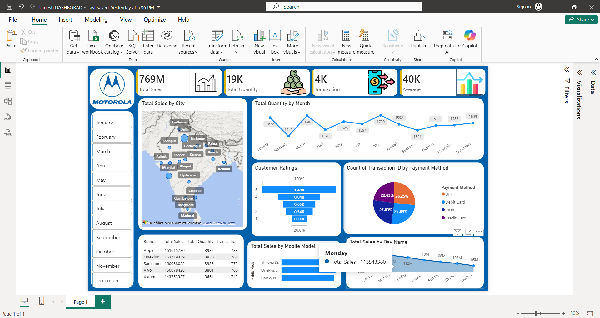

# 📱 Mobile Sales Data Dashboard | Power BI

## 📊 Project Overview

This project presents an interactive Mobile Sales Data Dashboard
created using Microsoft Power BI.

The dashboard helps analyze mobile sales performance across
different cities, brands, mobile models, payment methods,
customer ratings, and time periods.

## 🛠️ Tools & Technologies

- Microsoft Power BI
- Data Visualization
- Business Intelligence
- Data Analytics

## 📈 Key Features

- Total Sales and Total Quantity Analysis
- Sales Performance by City
- Monthly Sales Quantity Trends
- Customer Ratings Analysis
- Payment Method Distribution
- Sales by Mobile Brand and Model
- Sales by Day of the Week
- Interactive Month Filters

## 🖼️ Dashboard Preview

## 🎯 Project Objective

To transform mobile sales data into meaningful visual insights
that help understand sales trends and business performance.

## 👨‍💻 Author

Umesh Patil

## 🙏 Acknowledgement

Learned and developed this project with guidance from
Satish Dhawale through Skill Course learning resources.
